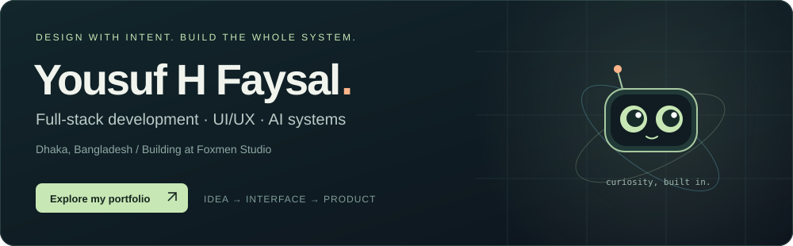
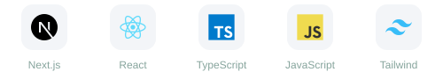
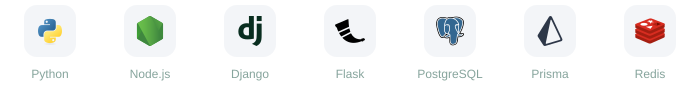
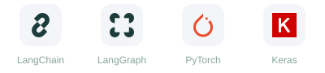

  

  
<a href="https://yousuf-faysal-portfolio.vercel.app/"><strong>Portfolio ↗</strong></a> &nbsp; · &nbsp; <a href="https://foxmen.studio">Foxmen Studio</a> &nbsp; · &nbsp; <a href="https://www.linkedin.com/in/yusuf-faysal/">LinkedIn</a> &nbsp; · &nbsp; <a href="mailto:yusufoesta7t@gmail.com">Email</a> &nbsp; · &nbsp; <a href="https://cal.com/yousuf-faysal/discussion-call">Book a conversation</a>

## I turn ideas into working products.

I’m **Yousuf Hossain Faysal**, a full-stack software developer and UI/UX designer based in **Dhaka, Bangladesh**. I work across the entire product: understanding the problem, designing in Figma, building the interface and backend, modelling the data, and keeping it running after launch.

My focus is **thoughtful interfaces, practical AI integrations and complete systems**. I use Claude Code, MCP, Cursor and other AI tools as part of my workflow, while owning architecture, verification and delivery decisions.

**Currently:** building at [Foxmen Studio](https://foxmen.studio), developing [The Cortex](https://github.com/yousuffaysal/cortex), and exploring agent orchestration and deep-learning frameworks.

---

## Selected work

A few projects that show how I connect design, engineering and AI. Each case study includes the brief, key features, screenshots and implementation notes.

<table>
<tr>
<td width="50%" valign="top">

<h3>Hotel Valentino</h3>

<strong>AI reception &amp; hotel booking</strong>

A hospitality platform with room discovery, availability-aware reservations and a conversational receptionist.

Next.js · Prisma · Neon · Groq

<a href="https://valentino-a-modern-resturent-and-mo.vercel.app/">Live demo ↗</a> &nbsp; · &nbsp; <a href="https://yousuf-faysal-portfolio.vercel.app/projects/hotel-valentino/">Case study</a> &nbsp; · &nbsp; <a href="https://github.com/yousuffaysal/Valentino-A-modern-Resturent-and-Motel-with-Agentic-System">Source</a>

</td>
<td width="50%" valign="top">

<h3>Redleaf — Fashion</h3>

<strong>AI-assisted fashion commerce</strong>

Catalog, variants, stock and order flows, with Aria helping shoppers discover products from the catalog.

Next.js · TypeScript · PostgreSQL · RAG

<a href="https://ecom-x-frontend.vercel.app/">Live demo ↗</a> &nbsp; · &nbsp; <a href="https://yousuf-faysal-portfolio.vercel.app/projects/redleaf/">Case study</a> &nbsp; · &nbsp; <a href="https://github.com/yousuffaysal/Ecom-X_Frontend">Source</a>

</td>
</tr>
<tr>
<td width="50%" valign="top">

<h3>CORE</h3>

<strong>Operational software + machine learning</strong>

Sales, inventory, HR and a transaction ledger, backed by Python services for forecasting and anomaly detection.

Next.js · Django · FastAPI · Python

<a href="https://ai-erp-xjjh.vercel.app/">Live demo ↗</a> &nbsp; · &nbsp; <a href="https://yousuf-faysal-portfolio.vercel.app/projects/core-erp/">Case study</a> &nbsp; · &nbsp; <a href="https://github.com/yousuffaysal/AI_ERP">Source</a>

</td>
<td width="50%" valign="top">

<h3>Celeste</h3>

<strong>An AI multi-vendor marketplace</strong>

Independent vendors, isolated catalogs, order routing and semantic product discovery in a shared marketplace.

Next.js · TypeScript · PostgreSQL

<a href="https://celeste-beryl.vercel.app/">Live demo ↗</a> &nbsp; · &nbsp; <a href="https://yousuf-faysal-portfolio.vercel.app/projects/celeste/">Case study</a> &nbsp; · &nbsp; <a href="https://github.com/yousuffaysal/Celeste-Multi-Platform">Source</a>

</td>
</tr>
<tr>
<td width="50%" valign="top">

<h3>Folang</h3>

<strong>Computer vision for sign-language learning</strong>

Real-time hand landmarks and on-device classification provide immediate feedback. An experimental alphabet-learning model.

MediaPipe · TensorFlow.js · Next.js

<a href="https://folang-web.vercel.app/">Live demo ↗</a> &nbsp; · &nbsp; <a href="https://yousuf-faysal-portfolio.vercel.app/projects/folang/">Case study</a>

</td>
<td width="50%" valign="top">

<h3>BIRST</h3>

<strong>Institutional programmes &amp; training</strong>

A client platform for programme listings, publications, applications and enquiries, with content management for staff.

Next.js · Node.js · PostgreSQL

<a href="https://www.birstbd.com/">Live demo ↗</a> &nbsp; · &nbsp; <a href="https://yousuf-faysal-portfolio.vercel.app/projects/birst/">Case study</a>

</td>
</tr>
</table>

### More things I’m building

| Project | What it explores | Explore |
| :--- | :--- | :--- |
| **The Cortex** · In progress | A desktop agent with typed, permission-scoped MCP tools, persistent context and verification between actions. | [Source](https://github.com/yousuffaysal/cortex) · [Case study](https://yousuf-faysal-portfolio.vercel.app/projects/the-cortex/) |
| **Lyverne** · In development | An editorial fashion storefront, interactive product presentation, customer accounts and owner tools. Product concepts and payment integration remain in development. | [Source](https://github.com/yousuffaysal/lyverne) |
| **Redleaf BD** | A separate grocery storefront with Bengali product information, category-led browsing and taka pricing. | [Live](https://www.redleaf-bd.com/) · [Case study](https://yousuf-faysal-portfolio.vercel.app/projects/redleaf-bd/) |
| **Treax** | Verified-student team formation, real-time chat, progress logs and AI-assisted recommendations. | [Source](https://github.com/yousuffaysal/Treax) · [Live](https://treax.vercel.app/) |
| **My portfolio + Orbit** | An explorable filesystem-style portfolio with project galleries, colorful tooling and a grounded personal AI guide with live voice conversation. | [Explore](https://yousuf-faysal-portfolio.vercel.app/) |
| **Pandecora** · Private build | An incident-reporting platform focused on encrypted content and role-scoped review. | No public source or demo |

**Redleaf fashion and Redleaf BD groceries are two different projects.**

---

## My toolkit

### Interfaces

### Backend & data

### AI, machine learning & statistics

**Also in my workflow:** MCP · retrieval-augmented generation · tool calling · Groq · MiniMax · OpenAI API · MediaPipe · XGBoost · Antigravity IDE.

### Design & delivery

### Currently learning & exploring

**Learning:** LangChain and PyTorch. **Exploring:** LangGraph and Keras. These are learning directions, not claims of production experience.

[See my full toolkit →](https://yousuf-faysal-portfolio.vercel.app/info/tools/)

---

## Experience & foundations

| Team | Role | Period |
| :--- | :--- | :--- |
| [Foxmen Studio](https://foxmen.studio) | Software Developer — end-to-end client delivery | 2024–Present |
| [Void Studio](https://www.voidstudio.tech/) | Software Engineer · UI/UX & Web Development | 2024–2026 |
| [Sailors Agency](https://sailorsagency.com/) | Full-Stack Developer · UI/UX Designer | Mar 2025–Jan 2026 |
| [3D WebMasters](https://3dwebmasters.framer.website/) | Web Application Developer | May–Dec 2025 |

**B.Sc. (Hons) in Statistics** — Noakhali Science and Technology University · 2026 · CGPA 3.67/4.00.

My statistics background supports how I approach data, forecasting and uncertainty. I learn the underlying concept, test assumptions and work through unfamiliar problems deliberately.

<strong>Certifications & continued learning</strong>

- **Anthropic:** Claude Code 101 and Claude 101 — 2026
- **Ostad:** Full Stack Web Development with Python, Django & React
- **Udemy:** HTML5, Python & Flask; Hands-On Python Machine Learning — 2025
- **Ongoing:** RAG, agent architectures, evaluation, production AI and deep learning

---

  <h3>Have a useful problem to solve?</h3>
  
Let’s talk about the product, the people who need it, and what it takes to build it well.

  
<a href="mailto:yusufoesta7t@gmail.com"><strong>Start a conversation →</strong></a> &nbsp; · &nbsp; <a href="https://yousuf-faysal-portfolio.vercel.app/">Explore my work</a>

